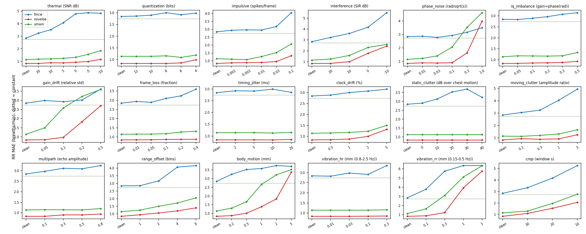
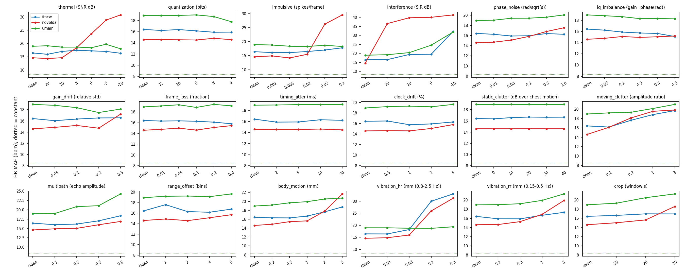

# UWB-Radar-Vital-Sign-Uncertainty-Estimation

**Dual Uncertainty Quantification for Multi-Radar Respiration and Heart-Rate Estimation Under Controlled IQ-Level Degradations**

[](LICENSE)
[](https://www.python.org/)
[](https://pytorch.org/)
[](#-release-roadmap)

This repository contains the official benchmark and physical degradation library (**RadarNoiseBench**) for contactless vital-sign estimation and uncertainty quantification across three radar architectures:
- **FMCW 79 GHz** (TI AWR1243 + DCA1000, $\lambda = 3.8\text{ mm}$)
- **Novelda 7.25 GHz IR-UWB** ($\lambda = 41.4\text{ mm}$)
- **UMAIN 4.60 GHz IR-UWB** ($\lambda = 65.2\text{ mm}$)

All signals are kept at the **complex slow-time IQ level** (`16 range bins × 800 frames @ 20 Hz`) extracted from the **TIM 2026 Multi-Radar Vital-Sign Dataset** ([`NguyenVanKhai2412/Camera-UWB_Radars-Fusion-VitalEstimation`](https://github.com/NguyenVanKhai2412/Camera-UWB_Radars-Fusion-VitalEstimation.git)), so that receiver, oscillator, timing, scene, and subject impairments can be injected **physically before demodulation**, anchored to each window's native dynamic chest-motion power $P = \operatorname{mean}_t |z_{k_0}(t) - \bar{z}_{k_0}|^2$.

---

## 🗺️ Release Roadmap

This repository is organized into modular release stages accompanying our manuscript (*Dual Uncertainty Quantification for Multi-Radar Respiration and Heart-Rate Estimation Under Controlled IQ-Level Degradations*):

| Component | Module / Path | Status |
|---|---|---|
| **Base Multimodal Dataset (TIM 2026)** | [`Camera-UWB_Radars-Fusion-VitalEstimation`](https://github.com/NguyenVanKhai2412/Camera-UWB_Radars-Fusion-VitalEstimation.git) | ✅ **Available** |
| **Part 1: Controlled IQ-Level Degradation Library & Classical Survey** | [`radarnoise/`](radarnoise/), [`examples/`](examples/), [`scripts/`](scripts/), [`results/REPORT.md`](results/REPORT.md) | ✅ **Published** |
| **Part 2: Multi-Radar Cardiac Processing (`p6`/`p4h`), Quality Gate & `HRSpecNet`** | `radarnoise/cardiac.py`, `radarnoise/hrnet.py`, `radarnoise/train_hr.py` | 🚧 **Coming soon!** |
| **Part 3: Dual Uncertainty Quantification (Aleatoric + Epistemic + Conformal + Multi-Radar Fusion)** | `radarnoise/uncertainty_model.py`, `radarnoise/train_uncertainty.py`, `scripts/dual_uq.py` | 🚧 **Coming soon!** |
| **Preprocessed Slow-Time IQ Windows (`*_w40_s2.npz`) & Trained Checkpoints** | [`data/`](data/) (17 subjects `S01`–`S17`, 12 conditions, 10,089 windows/radar) | 🚧 **Coming soon!** |

> 💡 **Run Immediately Without Waiting for the Full Preprocessed IQ Windows:**
> [`radarnoise/data.py`](radarnoise/data.py) includes a built-in physical synthetic IQ generator (`synthetic_windows()`), so [`examples/quickstart.py`](examples/quickstart.py) and [`scripts/check_pipeline.py`](scripts/check_pipeline.py) run out-of-the-box on CPU right after cloning!

---

## 📦 Repository Structure (Part 1)

```text
UWB-Radar-Vital-Sign-Uncertainty-Estimation/
├── README.md                        # Overview, benchmark tables, and release roadmap
├── requirements.txt                 # Python dependencies (numpy, scipy, torch, matplotlib)
├── LICENSE                          # MIT License
├── assets/                          # Degradation curves for RR and HR across 3 radars
│   ├── degradation_rr.png
│   └── degradation_hr.png
├── data/
│   ├── README.md                    # Dataset schema and download instructions (Coming soon!)
│   └── splits.json                  # Subject-disjoint 5-fold cross-validation splits (S01–S17)
├── radarnoise/                      # Part 1 Python package
│   ├── __init__.py
│   ├── constants.py                 # Sensor parameters (FMCW 79 GHz, Novelda 7.25 GHz, UMAIN 4.6 GHz)
│   ├── data.py                      # load(), subject-disjoint split(), and synthetic_windows()
│   ├── demod.py                     # PyTorch IQ -> displacement (mm): Kåsa circle-fit arctan & UWB projection
│   ├── dsp.py                       # Reference NumPy/SciPy signal-processing routines
│   ├── noise.py                     # 17 physical IQ-level degradations across 5 families (NOISES registry)
│   ├── noise_v2.py                  # Body-only motion & common-mode clutter phase reference extensions
│   ├── estimators.py                # Classical FFT/ACF estimators (chest, best-SNR, 16-bin avg) & spectral SQI
│   ├── survey.py                    # Noise × level × estimator benchmark survey runner
│   └── report.py                    # Survey -> results/REPORT.md + degradation figures
├── examples/
│   └── quickstart.py                # 5-minute interactive tour (auto-falls back to synthetic IQ windows)
├── scripts/
│   ├── check_pipeline.py            # Verifies all 17 noises × 77 levels + demodulation + estimators on CPU
│   └── check_demod.py               # Verifies batched PyTorch demodulation against NumPy DSP reference
└── results/
    ├── REPORT.md                    # Complete Part 1 classical survey tables across all 3 radars
    └── figs/
        ├── degradation_rr.png
        └── degradation_hr.png
```

---

## 🚀 Quickstart

### 1. Installation

```bash
git clone https://github.com/thetuantrinh/UWB-Radar-Vital-Sign-Uncertainty-Estimation.git
cd UWB-Radar-Vital-Sign-Uncertainty-Estimation
pip install -r requirements.txt
```

### 2. Run the 5-Minute Tour & Pipeline Sanity Checks (CPU)

Works immediately out-of-the-box using built-in synthetic IQ windows (or automatically loads `data/{radar}_w40_s2.npz` when placed in `data/`):

```bash
# Quick tour: compare clean vs. body_motion @ 2.0 mm on Novelda IR-UWB
python examples/quickstart.py --radar novelda --noise body_motion --level 2.0

# Verify all 17 IQ-level noise models (77 severity levels) across FMCW, Novelda, and UMAIN
python scripts/check_pipeline.py

# Verify PyTorch batched demodulation vs. NumPy reference DSP
python scripts/check_demod.py
```

### 3. Inject Physical IQ-Level Degradations in Python

```python
import torch
from radarnoise.constants import FS_OUT, RADARS
from radarnoise.data import synthetic_windows
from radarnoise.demod import demodulate
from radarnoise.estimators import estimate
from radarnoise.noise import apply

# 1. Load or generate complex slow-time IQ windows: (B, 16 range bins, 800 frames @ 20 Hz)
W = synthetic_windows("novelda", n=32)
z = torch.as_tensor(W["iq"])
k0 = torch.as_tensor(W["chest_k"])

# 2. Inject 0 dB SNR thermal noise (or any of the 17 degradations) BEFORE demodulation
ctx = dict(k0=k0, lam=RADARS["novelda"]["wavelength_m"], fs=FS_OUT)
z_noisy = apply("thermal", z, level=0, g=torch.Generator().manual_seed(0), ctx=ctx)

# 3. Demodulate IQ -> chest displacement (mm) and estimate RR / HR
disp_mm = demodulate("novelda", z_noisy)          # (32, 16, 800) mm
preds = estimate(disp_mm.float(), FS_OUT, k0)     # {'rr_fft_snr', 'hr_fft_snr', ...}
```

---

## 🔬 Part 1: Controlled IQ-Level Degradation Taxonomy (`radarnoise/noise.py`)

All 17 impairments (77 severity levels, plus 3 observation window lengths in `survey.py`) are applied directly to the complex slow-time matrix $Z \in \mathbb{C}^{B \times 16 \times L}$ **before** demodulation. Noise powers are anchored to each window's dynamic chest-bin power $P = \operatorname{mean}_t |z_{k_0}(t) - \bar{z}_{k_0}|^2$:

| Family | Degradation (`NOISES` key) | Severity Levels (Mild → Severe) | Physical Mechanism |
|---|---|---|---|
| **Receiver** | `thermal` | `20, 10, 5, 0, -5, -10` dB SNR | Additive circular complex Gaussian receiver noise |
| | `quantization` | `12, 10, 8, 6, 4` bits | Uniform mid-tread ADC quantization on I and Q |
| | `impulsive` | `0.001, 0.003, 0.01, 0.03, 0.1` /frame | Broadband EMI spikes ($10\sqrt{P}$) at Bernoulli frames |
| | `interference` | `20, 10, 0, -10` dB SIR | Co-channel complex sinusoid with random Doppler in $[-3, 3]\text{ Hz}$ |
| **Oscillator** | `phase_noise` | `0.01, 0.03, 0.1, 0.3, 1.0` $\text{rad}/\sqrt{\text{s}}$ | Wiener random-walk phase drift common across bins |
| | `iq_imbalance` | `0.05, 0.1, 0.2, 0.3, 0.5` | Quadrature gain/phase mismatch $\varepsilon$ + complex DC offset |
| | `gain_drift` | `0.05, 0.1, 0.2, 0.5` rel. std | Slow AGC amplitude modulation in $[0.01, 0.3]\text{ Hz}$ |
| **Timing** | `frame_loss` | `0.01, 0.05, 0.1, 0.2, 0.4` fraction | Burst packet drops (5 frames) with zero-order hold |
| | `timing_jitter` | `2, 5, 10, 20` ms | Random per-frame sampling-instant jitter |
| | `clock_drift` | `0.5, 1, 2, 5` % | Frame clock rate skew $\pm\delta\%$ |
| **Scene** | `static_clutter` | `0, 10, 20, 30, 40` dB over $P$ | Strong stationary reflector per range bin |
| | `moving_clutter` | `0.1, 0.3, 1, 3` amp. ratio | Secondary moving scatterer ($2\text{ mm}$ std in $[0.05, 1]\text{ Hz}$) |
| | `multipath` | `0.1, 0.3, 0.5, 0.8` echo ratio | Delayed dynamic echo ($0.1\text{–}0.5\text{ s}$) with random phase |
| | `range_offset` | `1, 2, 4, 8` bins | Target shifted off the assumed chest bin $k_0$ |
| **Subject** | `body_motion` | `0.2, 0.5, 1, 2, 5` mm | Postural drift ($<0.3\text{ Hz}$) + Poisson jerks |
| | `vibration_hr` | `0.01, 0.03, 0.1, 0.3` mm | Platform vibration inside cardiac band ($0.8\text{–}2.5\text{ Hz}$) |
| | `vibration_rr` | `0.1, 0.3, 1, 3` mm | Platform vibration inside breathing band ($0.15\text{–}0.5\text{ Hz}$) |
| **Observation** | `crop` *(in `survey.py`)* | `30, 20, 10` s | Reduced observation window length (from 40 s) |

---

## 📊 Key Benchmark Results (Part 1 Classical Survey)

Evaluated under **strictly subject-disjoint 5-fold cross-validation** across 17 unseen subjects (`S01`–`S17`, 824 best-case windows at 0.5 m, facing, still; 10,089 total windows across all 12 conditions). Full tables are in [`results/REPORT.md`](results/REPORT.md).

### Clean Accuracy on Unseen Subjects (Best-Case Windows)

| Metric | Novelda (7.25 GHz UWB) | UMAIN (4.60 GHz UWB) | FMCW (79 GHz) | Constant Baseline (Train Mean) |
|---|---|---|---|---|
| **RR Clean MAE (breaths/min)** | **0.84** (92% $\le 2$) | **1.14** (86% $\le 2$) | 2.84 (58% $\le 2$) | 2.74 (43% $\le 2$) |
| **HR Clean MAE (bpm, single-bin)** | 14.61 (26% $\le 5$) | 19.01 (19% $\le 5$) | 16.42 (25% $\le 5$) | **8.35** (42% $\le 5$) |

### Degradation Curves Across 17 Physical Impairments

#### Respiration Rate (RR) Degradation


#### Heart Rate (HR) Degradation


### Summary of Findings (Part 1)
1. **Respiration Rate (RR):** Novelda (`0.84 br/min`) and UMAIN (`1.14 br/min`) approach the inter-reference agreement (`0.85 br/min` between depth camera and PPG). RR breaks down primarily under **breathing-band vibration** ($\ge 1\text{ mm}$ on Novelda, $\ge 0.3\text{ mm}$ on UMAIN), **gain drift**, **phase noise** (UMAIN from $0.03\text{ rad}/\sqrt{\text{s}}$), **body motion**, and **short windows** ($\le 20\text{ s}$).
2. **Clutter-Leakage Mechanism:** Linear UWB demodulation is invariant to pure static clutter by construction, whereas gain drift and phase drift leak into the displacement proportional to the static-to-dynamic clutter ratio $\eta = |\bar{z}_{k_0}| / \sqrt{P}$ (median $\eta = 2.0$ on Novelda vs. $6.8$ on UMAIN).
3. **Harmless Impairments for RR:** Quantization down to 6 bits, timing jitter up to 20 ms, burst frame loss up to 40% (with zero-order hold), IQ imbalance, and multipath have negligible effect on UWB RR estimation.
4. **Single-Bin Heart Rate (HR):** No single-bin classical estimator beats the training-subject population mean (`8.35 bpm`) on unseen subjects (`14.6–19.0 bpm`), motivating the multi-radar cardiac processing chain in **Part 2**.

---

## 🚧 Coming Soon! (Parts 2 & 3 + Full Dataset)

### Part 2: Multi-Radar Cardiac Processing Chain & Personalised Enrolment *(Coming soon!)*
- **Breathing Harmonic Regression & Cross-Bin PCA:** Least-squares removal of 12 respiratory harmonics per bin followed by spatial PCA and Welch spectral estimation.
- **Dual Spectral Chains (`p6` & `p4h`):** Velocity-weighted harmonic sum (`p6`) for normal/fast heart rates and unweighted harmonic sum (`p4h`) for slow heart rates ($<60\text{ bpm}$).
- **Quality Gate & Personalised Enrolment Rule:** Reduces 17-subject HR MAE from `15.8 bpm` to **`7.61 bpm`** (`7.09 bpm` best-case) label-free, and **`4.39 bpm`** (`3.99 bpm` best-case) with a single enrolment window (`HRSpecNet` + rule).

### Part 3: Dual Uncertainty Quantification & Multi-Radar Fusion *(Coming soon!)*
- **Learned Aleatoric & Epistemic Decomposition:** Dilated residual 1D CNN (`RadarUncertaintyNet`) with **MC-Dropout**, **Deep Ensembles**, and **Deep Evidential Regression (DER)** trained with $\beta$-NLL loss, plus **Split Conformal Prediction** recalibration.
- **Silent Failure Discovery:** Demonstrates that while epistemic uncertainty detects out-of-distribution receiver/scene corruptions (AUROC `0.70–0.88`), **in-band breathing-like degradations (`vibration_rr`, `gain_drift`) evade all learned UQ methods** (AUROC $\approx 0.50$, conformal coverage dropping from `97%` to `55%`), and compares learned UQ against the free classical spectral SQI ($1/\text{SNR}$).
- **Inverse-Variance Multi-Radar Fusion:** ReducesRR error by `16–26%` over uniform averaging when one radar is degraded.

## 📬 Contact
**Minhhuy Le** (`huy.leminh@phenikaa-uni.edu.vn`)
- Faculty of Electrical and Electronic Engineering & Intelligent Communication System Laboratory (ICSLab), Phenikaa University, Hanoi, Vietnam.
